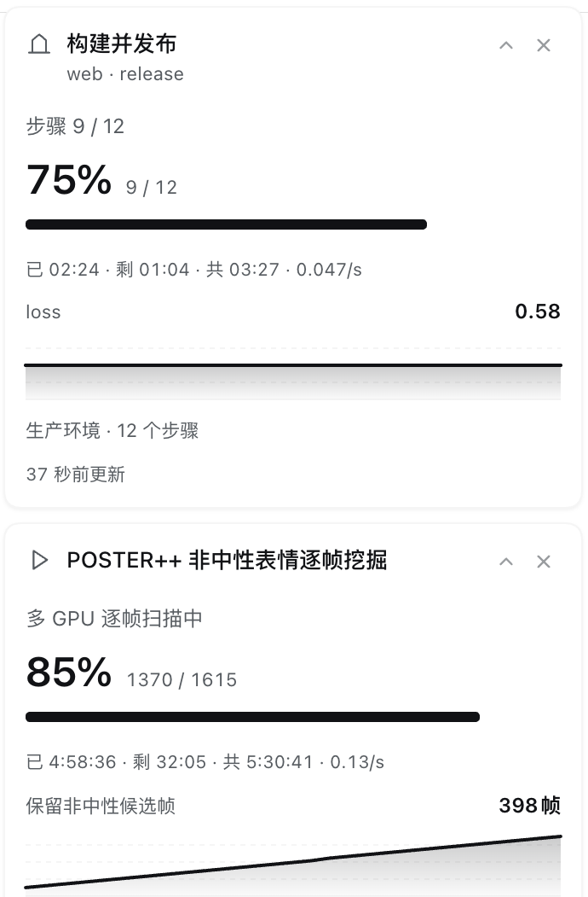

# Live activities

English · [简体中文](README.md)

A DeepSeek Harness (DSH) plugin: an agent creates a live activity card for running work, and the card floats above the DSH window showing progress updates. It stays visible after the reply ends, and phase, progress, rate and estimated time left refresh as the work advances.



## Install

A DSH plugin is installed as a "bundle", and this repository is one:

```sh
git clone https://github.com/Tippye/dsh-live-activity.git
```

Then open **Plugins** in DSH, choose **Add plugin** and select the cloned directory, then enable `@local/dsh-live-activity`. Its dependency (`zod`) resolves during installation, so no manual `npm install` is needed. No configuration is required afterwards.

Current version `1.8.1` (the manifest is authoritative). The repository directory *is* the installed plugin — the profile holds a `link:` symlink — so `git pull` updates it; reload Host code from the **Plugins** panel and refresh the window after editing `client.js`.

Disabling or uninstalling the bundle keeps the stored card records in your profile; re-enabling shows them again.

## Why the card lives inside the app

A system desktop widget has to be hosted by the operating system and rendered independently of the application process. DSH Desktop is an Electron app, but Host plugins run inside a `dsh-desktop-host` child process launched with `ELECTRON_RUN_AS_NODE=1`. There `require('electron')` fails, `process.type` is undefined, and the IPC the child can send to the main process covers only `quit-inspection`, `update-tasks`, `platform-session` and `plugin-operation` — there is no window-creation request. A plugin therefore cannot create a native always-on-top window.

So the card renders inside the DSH window, in the `shell.overlay` slot: the frame-wide floating layer above every column and outside their scroll containers. It reads as a floating window pinned to the app, and it survives switching sessions.

Turning it into a real desktop-level window would need either `documentPictureInPicture.requestWindow()` from the client half (requires a user gesture, lifetime tied to the page) or a Host `ctx.subprocess` helper running a Swift/SwiftUI `NSPanel`. Neither ships in this version.

## What qualifies for a card

A card is only for work that keeps reporting a quantity that changes while it runs. Creation must supply one of these three, otherwise it is refused:

| Allowed | Example |
|---|---|
| Determinate fraction | `progress: 0.42` |
| item count | `completed: 120, total: 500` (derives 0.24) |
| Numeric series (chart) | `metrics: [{ "name": "loss", "value": 0.42 }]`, one more point per update, drawn as a line |

Refused: status-only narration, an already finished step, an ETA on its own, a single tool call, a decision or confirmation. Report these in the reply; use `dsh_board` when a durable checklist is needed. Once a card exists, an `update` may not drop both the progress and the series (call `end` to close it), so a card cannot degrade into a text-only badge.

## Timing and estimate

A progress card carries a timing line under the bar:

```
elapsed 00:14 · 00:01 left · 00:15 total · 1.1/s
```

- **elapsed**: measured from the card's `startedAt` and ticked locally in the
  browser every second, so it never depends on polling.
- **rate**: derived from the progress points the plugin records itself
  (`track`, at most 24 points, the first always kept) as
  `(latest − first) / Δt` — an average rate that needs nothing from the agent
  and is not thrown off by one jittery reading.
- **left / total**: `left = (total − done) ÷ rate`, `total = elapsed + left`.
  Until a rate exists (only one point), the agent's `etaEpochSeconds` is used
  for the remaining time; with neither, only "elapsed" is shown.
- **An ended card** freezes its elapsed time and drops left/total; a
  **series-only** card still shows elapsed, keeping its runtime visible.

Agents and HTTP callers see the same derivation in `get` / `list`:

```json
"timing": { "elapsedMs": 14000, "rate": 1.1, "remainingMs": 900, "totalMs": 14900, "unit": "items" }
```

`unit` is `items` for a counting card (rate in items per second) and `fraction`
for a proportional one.

## Look

The card follows the visual language of [shadcn charts](https://ui.shadcn.com/charts/area): a flat card (1 px border, near-flat shadow, no glassmorphism); a `13px/500` title over a `12px` muted phase line; progress as a `24px/600` tabular percentage with a 6 px rounded track; one area chart per numeric series — 2 px stroke, a gradient fill fading downward, three dashed horizontal grid lines; a `10.5 px` muted line under the bar carries the timing (elapsed/left/total/rate); times and states as outlined badges instead of coloured pills. Every colour comes from `--dsw-alias-*` theme tokens, so light and dark themes both hold.

## Use

Once enabled, nothing to configure. Ask the agent to do something with progress to watch and it opens a card on its own:

- "Build and deploy the web bundle, and keep the card's `completed`/`total` current."
- "Run the full test suite; show how many tests have passed."
- "Train this model for 200 epochs and plot the loss on the card."
- "Deploy to staging, and end the card when it's done."

A status-only task ("check the version", "verify where the report came from") is refused; the agent reports the result in the reply. The same restriction applies to pre-existing status cards: they can no longer be `update`d, but they can still be `end`ed.

Cards appear in the window's top-right corner (`top: 72px; right: 20px`) by default, flowing downward when there are several. **Each card is independent:**

| Action | How |
|---|---|
| Drag | Drag a card's header (or its collapsed pill) to move just that card; focus it and use the arrow keys for the same, `Shift` + arrows for 4 px steps |
| Collapse | The chevron in the header folds that one card into a slim pill (dot, title, phase, value); click the pill or press Enter to expand it, and the pill still drags and closes |
| Close | The × in the header or on the pill removes that one card (the same as `live_activity` with `dismiss`) |

Each card keeps its own position and collapsed state in local storage under its id, so they survive a restart; layout records of removed cards are dropped on the next poll. If the card route fails 3 polls in a row, a dismissible "Live activities are unavailable" notice appears once, instead of every card reporting its own error.

## Agent API

`live_activity` is the only entry point and shares one store with the floating cards. Examples:

```json
{"action":"create","title":"Build and deploy","subtitle":"prod","phase":"Compiling","completed":120,"total":500,"etaEpochSeconds":1763650000,"staleAfterSeconds":300,"symbol":"build"}
```

```json
{"action":"create","title":"Train YOLO","phase":"Epoch 1","metrics":[{"name":"loss","value":0.92}]}
```

```json
{"action":"update","id":"<id>","phase":"Epoch 2","metrics":[{"name":"loss","value":0.71},{"name":"lr","value":0.0003}]}
```

```json
{"action":"end","id":"<id>","phase":"Released","dismissalPolicy":{"afterSeconds":120}}
```

```json
{"action":"list","status":"active"}
```

- `create` requires `title`, `phase`, and one of `progress`, `completed`+`total`, or `metrics`. `symbol` is one of `task`/`run`/`build`/`deploy`/`download`/`search`/`sync`/`alert`; `accent` is one of `brand`/`success`/`warn`/`error`/`idle`.
- In `update`/`end`, `phase`, `detail`, `progress` and `etaEpochSeconds` merge partially: omit to keep, pass `null` to clear (`progress: null` also clears `completed`/`total`).
- `completed`/`total`: `total` must be a positive integer and `completed` is clamped into `[0, total]`; sending `completed` alone reuses the previous total, which suits a loop with a fixed length.
- `metrics`: each call appends one point per named series — an existing name continues that series, a new name starts one (at most 3 series, latest 60 points each); `metrics: null` clears every series.
- `dismissalPolicy`: `"default"` keeps the final state for 10 minutes, `"immediate"` removes it at once, `{"afterSeconds":n}` keeps it for a custom 1–14400 seconds.
- At most 8 cards are active at once; end an old card first.

The following actions do not modify card data and exist only on the tool side:

| Action | Purpose |
|---|---|
| `endpoint` | the program endpoint URL, the token file, and its usage |
| `settings` | the bound address, both switches, and the active tunnels |
| `set-lan-access` / `set-allow-tunnel` | flip LAN access or SSH tunnels (writes the profile config) |
| `tunnel` | `operation: "start" \| "stop" \| "list"` manages tunnels |

**The program-facing HTTP endpoint is deliberately narrower than the tool**: it
accepts only the card actions `create`/`update`/`end`/`dismiss`/`list`/`get`. It
cannot read settings, change a switch, or open a tunnel, so a leaked token
cannot widen the attack surface through it.

## Driven by a program (HTTP endpoint)

Progress can also bypass the agent: the plugin serves a local HTTP
endpoint on `127.0.0.1:41363`, and `action: "endpoint"` returns its URL and the
token file that authorizes it. The same operations and gate apply; a
status-only request still returns 422.

```sh
# the token file: 0600, created on first start, stable across restarts
cat ~/.dsh/plugin-data/dsh-live-activity/token

# the CLI from this repo reads it for you
node bin/live-activity.mjs '{"action":"create","title":"Train","phase":"Epoch 1","completed":1,"total":16}'
node bin/live-activity.mjs '{"action":"update","id":"<id>","completed":7,"metrics":[{"name":"loss","value":0.42}]}'

# or plain curl
curl -s http://127.0.0.1:41363 \
  -H "Authorization: Bearer $(cat ~/.dsh/plugin-data/dsh-live-activity/token)" \
  -H 'Content-Type: application/json' \
  -d '{"action":"update","id":"<id>","completed":9,"total":16}'
```

Python's standard library is enough, with no extra dependencies:

```python
import json, pathlib, urllib.request
token = pathlib.Path('~/.dsh/plugin-data/dsh-live-activity/token').expanduser().read_text().strip()
def call(payload):
    req = urllib.request.Request('http://127.0.0.1:41363', data=json.dumps(payload).encode(),
        headers={'Authorization': f'Bearer {token}', 'Content-Type': 'application/json'})
    return json.loads(urllib.request.urlopen(req, timeout=5).read())['value']

card = call({'action': 'create', 'title': 'Train', 'phase': 'Epoch 1', 'completed': 0, 'total': 16})
for epoch in range(16):
    call({'action': 'update', 'id': card['id'], 'completed': epoch + 1, 'metrics': [{'name': 'loss', 'value': 2.0 / (epoch + 1)}]})
call({'action': 'end', 'id': card['id'], 'phase': 'Training finished'})
```

The endpoint accepts `POST` only; a missing token answers 401, a body over 64 KiB
answers 413, and an unknown action answers 400.

### The LAN switch (off by default)

The plugin settings carry a **LAN access** switch: **Plugins** → the
`@local/dsh-live-activity` page → the toggle. It maps to this row's `config` in
the profile's `cordis.patch.yml`:

```yaml
- id: dsh-live-activity
  name: '@local/dsh-live-activity'
  config:
    lanAccess: false   # loopback only by default
    port: 41363
```

Turning it on binds `0.0.0.0:41363`, so every interface on this machine answers,
and `settings` returns addresses a script can paste directly:

```json
{"lanAccess":true,"host":"0.0.0.0","port":41363,"url":"http://192.168.100.176:41363","urls":["http://192.168.100.176:41363"]}
```

The switch applies immediately — saving the config makes the Loader reload the
row, which rebinds the listener — and no DSH restart is needed. Turning it off
returns to loopback at once. The agent can flip it too, via `live_activity` with
`set-lan-access` and `enabled: true|false`.

Be aware of the cost: with it on, any device on the same network can reach that
port; the token is the only gate and the traffic is plain HTTP. Keep it to a
network you trust and turn it back off afterwards.

### Machines on another network: the plugin opens the tunnel

When the other machine is not on your network, you do not have to open LAN
access or type the tunnel yourself. A second switch, **SSH tunnels** (off by
default), lets the agent open one with the tool:

```json
{"action":"tunnel","operation":"start","host":"183.147.142.103","user":"qujiwang","sshPort":63286,"identityFile":"~/.ssh/PathX","remotePort":41410}
```

That is equivalent to opening a port visible only to the remote host itself:

```sh
ssh -N -o BatchMode=yes -o ExitOnForwardFailure=yes \
    -o StrictHostKeyChecking=accept-new -o ServerAliveInterval=30 \
    -p 63286 -i ~/.ssh/PathX \
    -R 127.0.0.1:41410:127.0.0.1:41363 qujiwang@183.147.142.103
```

The remote script then posts to `http://127.0.0.1:41410` with the same bearer
token. The result carries `remoteUrl` and a usage note; `operation: "list"`
shows the tunnels, and `operation: "stop"` with a `tunnelId` closes one.

Behavior and limits:

- **Only the remote host can reach it.** The bind address is written explicitly
  as `127.0.0.1`, so even on that host only local processes can use the port.
- **It closes with the window and with DSH.** The tunnel is owned by this plugin
  instance: reloading the row (closing the window, disabling the plugin,
  changing its config) or a normal process exit terminates it.
- **A force-kill is the exception.** If DSH is `kill -9`ed or force quit,
  nothing can clean up and the ssh process may linger; finish with
  `pkill -f "ssh -N -R"`.
- **Reporting-source badge.** A card written through
    a tunnel shows a signal icon next to its title; hovering it shows the machine
  that reported the progress and the forwarding port
  (`183.147.142.103 · through the tunnel · 127.0.0.1:41410`). A card driven over
  the LAN shows the same icon labeled "on the local network"; local programs and
  agent writes add no badge. The badge also stays on the collapsed pill.
  - Internally, each tunnel opens its own **private loopback listener** (random
    port) as the `-R` target, because a forwarded request reaches the server
    from `127.0.0.1`; only per-listener attribution can name the far machine.
    That listener is closed with the tunnel.
- The remote bind address is pinned to IPv4 loopback: sshd binds a `-R` port
  to `[::1]` by default, so the explicit `127.0.0.1:` prefix keeps it reachable
  from IPv4 applications.

## Where things are

- `index.js` — tool registration, the `/api/dsh-live-activity` page route (cards may only be listed, read or dismissed; the page may also call `settings`, `set-lan-access` and `set-allow-tunnel` for its own two switches), the system prompt section, and a 15 second expiry sweep.
- `model.js` — validation, state merging, lifecycle derivation (`stale`, `expiresAt`, `dismissAt`), progress tracking and timing derivation (`track` / `timing`), and the store.
- `client.js` — the independent floating cards in `shell.overlay`: 2 second polling and a 1 second local recompute (neither the countdown nor elapsed/left/total depends on polling).
- `endpoint.js` — the program-facing HTTP endpoint: token check, body limit, busy-port fallback, bind-address selection, and per-listener source attribution.
- `tunnel.js` — reverse SSH tunnel argv construction and process supervision (spawned through `ctx.subprocess`, torn down with the instance); each tunnel owns a private loopback listener used to attribute its reports.
- The reporting source is stored on each card as `reporter` (`type`: `agent`/`local`/`lan`/`tunnel`, plus `ip`, `via`, `at`), refreshed on every write.
- `bin/live-activity.mjs` — single-request CLI that reads the token file and posts one payload.
- Records live in the profile's `dsh_live_activity` domain; a corrupt record is backed up and skipped instead of failing the whole plugin load.

## Known limits

- Cards are visible only while the DSH window is on screen; minimising it hides them. This is not a system desktop widget.
- Only the agent writes card content; the UI cannot edit phase or progress, only remove a card.
- Polling is 2 seconds, so an agent update reaches the card within about 2 seconds. Neither the countdown nor the elapsed/left/total line depends on polling.
- Left/total extrapolate the **average** rate, so a sudden change in speed takes a while to show; supply `etaEpochSeconds` when you need an exact deadline.
- A card is created by the agent through the tool or by a program through the HTTP endpoint; there is no manual "new card" control in the UI.
- The HTTP endpoint listens on loopback by default, needs an SSH tunnel or an explicit config change for other machines, and speaks plain HTTP with no TLS.
- A tunnel needs the remote to allow SSH port forwarding (the default) and an ssh client on this machine; ssh processes left behind by a force-killed DSH must be cleaned up by hand.
- Tunnel arguments are never a free-form command: host and user are character-restricted and the key path must be absolute — so the agent cannot assemble shell syntax.
- The card renders a built-in sparkline without axes, legends, or multi-series interaction; use an ECharts chart on a `dsh_board` for full charts.

## Privacy

Card content stays in your local profile storage and the plugin makes no outbound requests. Between the page and the Host there is only a same-origin `POST /api/dsh-live-activity`: card actions are limited to `list`/`get`/`dismiss`, and the page may additionally flip its own two switches (`settings`/`set-lan-access`/`set-allow-tunnel`). Writes have two legitimate paths — the agent tool, and the token-protected HTTP endpoint (`endpoint.js`, card actions only). The token lives in `~/.dsh/plugin-data/dsh-live-activity/token` (directory 0700, file 0600).

## Development

```sh
npm test          # model state machine and lifecycle + endpoint auth and gate + tunnel argv and process handling
```

After a change: reload Host code from the **Plugins** panel, and refresh the window once after editing `client.js`.

## License

[MIT](LICENSE) © 2026 Tippye