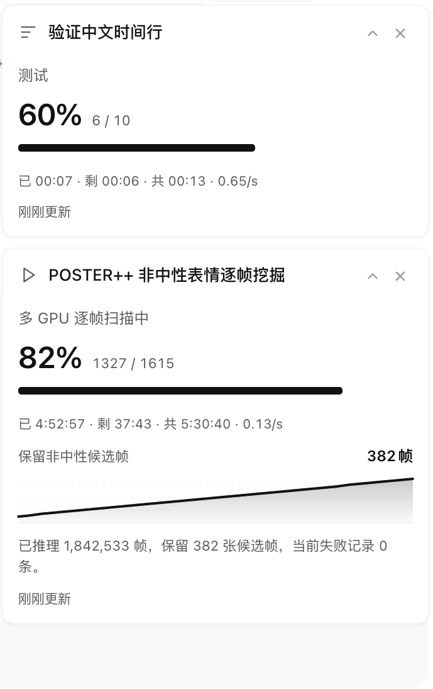

# dsh-live-activity

在 DeepSeek Harness 里展示长任务的实时进度：**一组给 agent / 程序用的写入接口 + 一个常驻窗口的悬浮卡片**。

- 卡片浮在 DSH 窗口之上（`shell.overlay` 浮层），回复结束后继续显示，切换会话不消失。
- 写入有两条路径：agent 的 `live_activity` 工具，以及本机 HTTP 接口（供构建脚本、训练循环、设备直接上报）。
- 每张卡片独立拖拽、折叠、关闭；位置和折叠状态按卡片 id 记在浏览器本地。
- 默认只监听 `127.0.0.1`。局域网访问与 SSH 隧道是两个独立开关，默认关闭，开启即时生效，无需重启。

## 界面



## 卡片显示

| 区域 | 内容 |
| --- | --- |
| 标题栏 | 图标、标题、副标题（可选），右侧是折叠与关闭按钮；也是拖拽把手 |
| 阶段 | `phase` 文本 |
| 进度 | `completed/total` 计数或 `progress` 比例，下方是进度条 |
| 时间 | 已用时间、按实测速率外推的剩余时间、总时间、速率 |
| 序列 | 每条 `metrics` 序列一张面积图，右上角显示最新值 |
| 状态 | ETA 时间点、待更新、已结束 |
| 上报来源 | 非本机写入时，标题后显示图标；悬停显示上报机器与端口 |

## 准入规则

创建卡片必须提供 `progress`、`completed`+`total`、`metrics` 三者之一，否则返回 `NOT_PROGRESS_TRACKING`（HTTP 422）。以下情况不适用：仅有阶段描述的更新、已完成的步骤、仅含 ETA 的任务、一次性工具调用、纯决策或确认——这类内容应写入回复，需要持久清单用 `dsh_board`。

已存在的卡片在 `update` 时不能同时清空进度和序列（结束请调用 `end`）。v1.1.0 之前创建的纯状态卡片仍可 `end`，但不能 `update`。

## 工具

`live_activity` 是唯一入口，与悬浮卡片共用同一个 store。

| `action` | 用途 |
| --- | --- |
| `create` | 创建卡片。需要 `title`、`phase` 与准入三者之一 |
| `update` | 局部更新 `phase` / `detail` / `progress` / `completed` / `total` / `metrics` / `etaEpochSeconds` / `staleAfterSeconds` / `relevance` |
| `end` | 结束卡片，`dismissalPolicy` 控制终态保留时长 |
| `dismiss` | 立即删除卡片记录 |
| `list` / `get` | 读取卡片，返回含 `timing` 推导结果 |
| `endpoint` | 返回程序接口地址与令牌文件路径 |
| `settings` | 读取监听地址、开关状态、活动隧道 |
| `set-lan-access` / `set-allow-tunnel` | 切换局域网访问 / SSH 隧道（写入 profile 配置） |
| `tunnel` | `operation: "start" \| "stop" \| "list"` 管理隧道 |

固定属性 `title`、`subtitle`、`symbol`、`accent` 创建后不可修改；内容状态可反复更新。`symbol` 取 `task`/`run`/`build`/`deploy`/`download`/`search`/`sync`/`alert`，`accent` 取 `brand`/`success`/`warn`/`error`/`idle`。

```json
{"action":"create","title":"构建发布","subtitle":"prod","phase":"编译中","completed":120,"total":500,"etaEpochSeconds":1763650000,"symbol":"build"}
```

```json
{"action":"update","id":"<id>","phase":"上传产物","completed":430,"metrics":[{"name":"loss","value":0.42}]}
```

```json
{"action":"end","id":"<id>","phase":"已发布","dismissalPolicy":{"afterSeconds":120}}
```

- `update` / `end` 的 `phase`、`detail`、`progress`、`etaEpochSeconds` 是局部合并：省略保留，传 `null` 清除（`progress: null` 同时清除 `completed`/`total`）。
- `completed` 会被夹到 `[0, total]`；只传 `completed` 时沿用上次的 `total`。
- `metrics` 每次调用为每条序列追加一个点，同名续写、新名新建，最多 3 条序列、每条保留最近 60 点；`metrics: null` 清空全部。
- `dismissalPolicy`：`"default"` 保留 10 分钟，`"immediate"` 立即移除，`{"afterSeconds":n}` 自定义 1–14400 秒。
- 同一时刻最多 8 张活动卡片；记录上限 32 条。

## 程序接口

插件在 `127.0.0.1:41363` 提供 HTTP 接口，操作与门禁和工具一致。动作集比工具窄：只支持卡片的 `create` / `update` / `end` / `dismiss` / `list` / `get`，无法读取设置、修改开关或建立隧道。

```sh
cat ~/.dsh/plugin-data/dsh-live-activity/token

node bin/live-activity.mjs '{"action":"create","title":"训练","phase":"Epoch 1","completed":1,"total":16}'
node bin/live-activity.mjs '{"action":"update","id":"<id>","completed":7,"metrics":[{"name":"loss","value":0.42}]}'

curl -s http://127.0.0.1:41363 \
  -H "Authorization: Bearer $(cat ~/.dsh/plugin-data/dsh-live-activity/token)" \
  -H 'Content-Type: application/json' \
  -d '{"action":"update","id":"<id>","completed":9,"total":16}'
```

Python 标准库即可，无需额外依赖：

```python
import json, pathlib, urllib.request
token = pathlib.Path('~/.dsh/plugin-data/dsh-live-activity/token').expanduser().read_text().strip()

def call(payload):
    req = urllib.request.Request('http://127.0.0.1:41363', data=json.dumps(payload).encode(),
        headers={'Authorization': f'Bearer {token}', 'Content-Type': 'application/json'})
    return json.loads(urllib.request.urlopen(req, timeout=5).read())['value']

card = call({'action': 'create', 'title': '训练', 'phase': 'Epoch 1', 'completed': 0, 'total': 16})
for epoch in range(16):
    call({'action': 'update', 'id': card['id'], 'completed': epoch + 1,
          'metrics': [{'name': 'loss', 'value': 2.0 / (epoch + 1)}]})
call({'action': 'end', 'id': card['id'], 'phase': '训练完成'})
```

令牌文件为 0600，目录 0700，首次启动生成，重启不变。仅接受 `POST`；缺少或错误令牌返回 401，请求体超过 64 KiB 返回 413，未知 `action` 返回 400。

## 配置

在 **插件** 面板 → `@local/dsh-live-activity` 页面配置，或写入 profile 的 `cordis.patch.yml`：

```yaml
- id: dsh-live-activity
  name: '@local/dsh-live-activity'
  config:
    lanAccess: false   # 局域网访问，默认关闭
    allowTunnel: false # SSH 隧道，默认关闭
    port: 41363
```

### 局域网访问（默认关闭）

开启后监听 `0.0.0.0:41363`，同网段设备可直连 `http://<本机 IP>:41363`。切换即时生效，无需重启。安全注意：该端口对同网段所有设备开放，令牌是唯一认证手段，且为明文 HTTP；仅应在可信内网启用。

### SSH 隧道（默认关闭）

用于远端机器不在同一网段的情况。开启后 agent 可通过工具建立隧道：

```json
{"action":"tunnel","operation":"start","host":"183.147.142.103","user":"qujiwang","sshPort":63286,"identityFile":"~/.ssh/PathX","remotePort":41410}
```

等价于在远端执行：

```sh
ssh -N -o BatchMode=yes -o ExitOnForwardFailure=yes \
    -o StrictHostKeyChecking=accept-new -o ServerAliveInterval=30 \
    -p 63286 -i ~/.ssh/PathX \
    -R 127.0.0.1:41410:127.0.0.1:41363 qujiwang@183.147.142.103
```

远端脚本随后请求 `http://127.0.0.1:41410`。`operation: "list"` 查看活动隧道，`operation: "stop"` 配合 `tunnelId` 关闭指定隧道。

- 远端绑定地址固定为 `127.0.0.1`，不暴露给远端所在网络；每条隧道单独开一个私有回环监听，用于把上报归属到正确的机器。
- 隧道由插件实例持有，在行重新加载（关闭窗口、停用插件、修改配置）或进程正常退出时终止。DSH 被强制退出时 ssh 进程可能残留，可执行 `pkill -f "ssh -N -R"` 清理。
- `host` / `user` 有字符白名单，私钥路径必须是绝对路径或 `~/` 开头，不接受任意命令字符串。

## 卡片操作

| 操作 | 方式 |
| --- | --- |
| 移动 | 拖动标题栏（或折叠后的胶囊）移动该卡片；标题栏获得焦点后可用方向键移动，`Shift` + 方向键为 4 像素 |
| 折叠 | 标题栏的折叠按钮把该卡片收成胶囊；点击胶囊或按 Enter 展开 |
| 关闭 | 标题栏或胶囊上的 × 删除该卡片（等价于 `dismiss`） |

卡片默认在窗口右上角（`top: 72px; right: 20px`），多张时依次向下排列。与 `/api/dsh-live-activity` 连续 3 次通信失败时，显示一次可关闭的不可用提示。

## 生命周期

| 阶段 | 行为 |
| --- | --- |
| 创建 | 记录 attributes 与第一份内容状态 |
| 更新 | 局部合并内容状态；距上次更新超过 `staleAfterSeconds` 后标记为待更新 |
| 结束 | 提交终态，`dismissalPolicy` 决定终态保留时长 |
| 过期 | 创建后满 8 小时自动结束；结束后超过保留时长自动移除（最长 4 小时） |

记录保存在 profile 的 `dsh_live_activity` domain 中，DSH 重启后卡片仍在。损坏记录会被备份并跳过，不影响插件加载。

## 安装

已在 DeepSeek Harness `0.2.2-rc.5` 验证。

```sh
git clone https://github.com/Tippye/dsh-live-activity.git
```

```text
Plugins → Add plugin → 选择克隆出的目录 → 启用 @local/dsh-live-activity
```

也可由 agent 用 `plugin_manager` 的 `install_bundle` 安装该绝对路径。依赖 `zod` 由安装过程解析。启用后无需配置。

仓库目录即安装源（profile 中为 `link:` 软链），`git pull` 即完成升级；Host 代码变更在 **插件** 面板刷新，`client.js` 变更刷新一次窗口。

## 开发

```sh
npm test   # model 状态机与生命周期 + endpoint 鉴权与门禁 + tunnel argv 与进程管理
```

- `index.js` — 工具注册、`/api/dsh-live-activity` 页面路由、系统提示词、15 秒过期清理
- `model.js` — 校验、状态合并、生命周期推导（`stale` / `expiresAt` / `dismissAt`）、进度轨迹与 `timing` 推导
- `endpoint.js` — 程序侧 HTTP 接口：令牌校验、请求体上限、端口回落、绑定地址、上报来源归属
- `tunnel.js` — 反向 SSH 隧道的参数构造与进程管理（经 `ctx.subprocess` 托管）
- `client.js` — `shell.overlay` 中的悬浮卡片
- `bin/live-activity.mjs` — 读取令牌文件并发送单次请求的命令行客户端

## 限制

- 卡片仅在 DSH 窗口可见时显示，最小化后不可见；不是系统级桌面挂件。
- 卡片内容只能由 agent 或程序写入，界面不支持编辑（只能移除或折叠）。
- 轮询间隔 2 秒，写入到卡片刷新约有 2 秒延迟；倒计时与已用时间由浏览器本地计算。
- 剩余与总时间按平均速率外推，速度突变时需一段时间收敛；需要精确时间请设置 `etaEpochSeconds`。
- 卡片图表为内置 sparkline，无坐标轴、图例与交互；需要完整图表请用 `dsh_board`。
- HTTP 接口默认仅监听回环地址，跨设备需 SSH 隧道或显式开启局域网访问，且不提供 TLS。

## 许可

[MIT](LICENSE) © 2026 Tippye